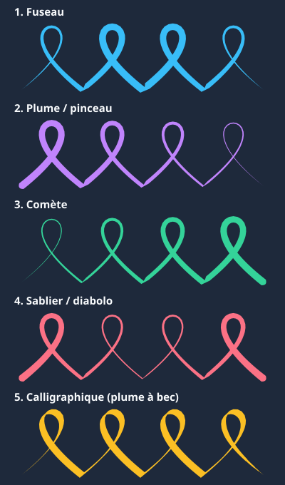
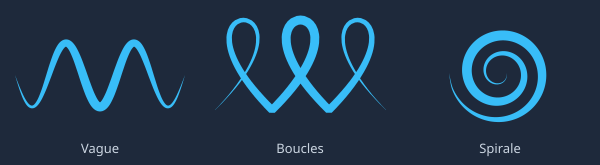
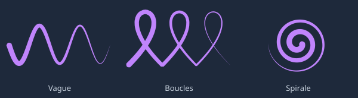
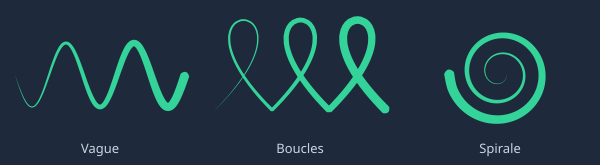
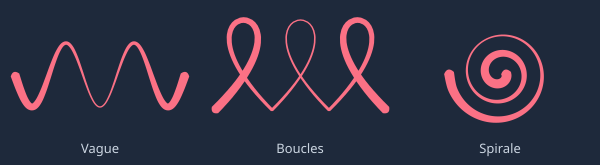
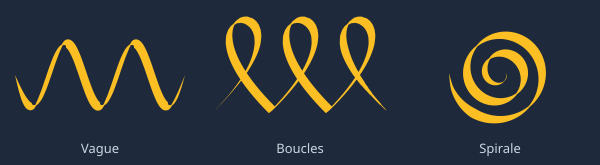

# Guide des effets de trait SVG

Pour demander un effet, il suffit de citer son **nom** et l'élément visé, par exemple : « applique l'effet **fuseau** aux reflets de mèches de la fille ».

Les 5 effets utilisent la même technique, la *stroked-to-filled path conversion* : au lieu d'un trait `stroke` d'épaisseur constante, on génère un `<path fill="...">` fermé, sans `stroke`, dont l'épaisseur varie le long de la courbe.



L'aperçu ci-dessus applique chaque effet à la même trajectoire à 4 boucles : on voit où le trait s'épaissit et s'affine sur toute sa longueur.

Dans chaque catégorie, l'effet est montré sur trois traits continus (vague, boucles, spirale) : le profil décide de l'épaisseur, la trajectoire décide de la forme. Un même effet s'applique donc à n'importe quelle courbe.

## 1. Fuseau

> **Nom à citer : `fuseau`** (symmetric spindle / football profile)
>
> Pointes à 0 aux deux bouts, ventre épais au centre.



Exemple de référence :

```svg
<path d="M 30,50 C 140,28 260,28 370,50 C 260,72 140,72 30,50 Z" fill="#38bdf8"/>
```

Usage avatar : cil inférieur, reflet de mèche, sourcil fin.

## 2. Plume / pinceau

> **Nom à citer : `plume`** (taper-out / brush feather profile)
>
> Départ large et arrondi, effilement continu jusqu'à une pointe d'aiguille.



Exemple de référence :

```svg
<path d="M 35,36 C 140,39 270,46 370,50 C 270,54 140,61 35,64 C 26,64 24,36 35,36 Z" fill="#c084fc"/>
```

Usage avatar : paupière supérieure (épaisse au coin externe), mèche fine qui tombe, pli de vêtement qui part de la taille et s'estompe.

## 3. Comète

> **Nom à citer : `comete`** (flare / expanding wedge profile)
>
> Pointe à 0 au départ, s'évase progressivement vers une tête large et arrondie.



Exemple de référence :

```svg
<path d="M 30,50 C 140,49 260,42 365,33 C 374,33 374,67 365,67 C 260,58 140,51 30,50 Z" fill="#34d399"/>
```

Usage avatar : la plume tracée dans l'autre sens. Paupière de l'œil droit (tracé de l'intérieur vers l'extérieur), pointe de mèche qui s'élargit vers le bas.

## 4. Sablier / diabolo

> **Nom à citer : `sablier`** (waisted / hourglass profile)
>
> Épais aux deux bouts, étranglement très fin au milieu.



Exemple de référence :

```svg
<path d="M 35,36 C 130,42 170,48.5 200,48.5 C 230,48.5 270,42 365,36 C 374,36 374,64 365,64 C 270,58 230,51.5 200,51.5 C 170,51.5 130,58 35,64 C 26,64 26,36 35,36 Z" fill="#fb7185"/>
```

Usage avatar : **toutes les bouches** (appliqué le 2026-10-11), pli de tissu tendu entre deux points.

## 5. Calligraphique

> **Nom à citer : `calligraphique`** (broad-nib / plume à bec biseauté)
>
> L'épaisseur dépend de la **direction** du trait, comme une plume tenue à 45° : fin en montant vers la droite (délié), épais en descendant (plein). Sur une droite, l'épaisseur reste constante.



Différence avec le fuseau : le fuseau est toujours épais au milieu et pointu aux bouts, quelle que soit la forme. Le calligraphique s'épaissit et s'affine plusieurs fois le long d'une même courbe, selon qu'elle monte ou descend.

Usage avatar : mèche ondulée, ruban, drapé de cape, tout trait qui doit avoir l'air dessiné à la plume.

## Réglages possibles dans une demande

- **Épaisseur** : « plus fin », « plus épais », ou une valeur (« 1.8 au maximum »).
- **Sens** : « épais à gauche » ou « épais à l'extérieur » (plume ou comète selon le sens du tracé).
- **Étranglement** du sablier : « centre plus fin » ou « plus marqué ».
- **Angle de plume** du calligraphique : « plein sur les montées » ou « plume à 30° ».

## Règles déjà appliquées aux avatars

Ces éléments sont en **fuseau** sur tous les avatars, et toute nouvelle tenue suit la même règle sans qu'il faille la redemander.

#### Coutures, plis, liserés et ourlets

Un trait fin qui s'effile aux deux bouts, à peine plus large que l'ancien trait (environ 1.2 fois). Les zigzags, comme la fourrure de la cape de l'Orc ou les lacets croisés du plastron de l'elfe, se découpent en un fuseau par segment pour garder des pointes nettes dans les angles. Une couture piquée (pointillés) devient une suite de petits fuseaux, un par point, comme sur le torse de l'archer.

#### Diadèmes, bandeaux et rubans de chapeau

Le fuseau donne la profondeur : épais au centre du front, il s'affine vers les tempes comme s'il passait derrière la tête. On joue sur l'épaisseur : environ 2 fois l'ancien trait pour un diadème fin (elfe 3.8, Orc 4.4), et 1.2 fois l'épaisseur de la bande pour un bandeau plein (mage 5.8, ruban du chapeau de la sorcière 6.2).

#### Ceintures

Même principe que les diadèmes : la bande est légèrement incurvée vers le bas pour suivre le tour de taille, épaisse sous la boucle et fine sur les hanches. Son épaisseur au centre vaut 1.35 fois la hauteur de l'ancienne ceinture.

Deux ajustements sont obligatoires :

- **Largeur ajustée à la taille** : les pointes tombent exactement sur les bords de la silhouette de la tenue, mesurés à la hauteur de la ceinture. Chaque tenue a sa propre largeur (de 22 pour la guerrière à 29 pour la sorcière), jamais une largeur commune : trop large, la ceinture dépasse comme des ailes ; trop étroite, elle flotte sur le ventre.
- **Éléments centrés verticalement** : boucle, gemme, rivets, sacoche ou pagne qui reposent sur la ceinture suivent sa courbe. Au centre, ils descendent de 1.2 ; vers les hanches, de moins en moins.

#### Boucles d'oreille et anneaux

Un anneau est un cercle **ouvert** sur environ 80 % du tour, tracé en fuseau : épais en bas, il s'affine en pointe aux deux bords de l'ouverture. L'ouverture se pose à cheval sur le rebord de l'oreille : les deux pointes reposent sur l'oreille et l'anneau pend à l'extérieur, ce qui donne l'impression qu'il la traverse. Le même principe sert pour un anneau de nez, un maillon de chaîne ou un piercing. Seul le placement se règle au cas par cas : il suffit de demander, par exemple, « un anneau d'oreille en or sur l'elfe, ouverture vers l'arrière ».

## Exemples de demandes

- « Applique **plume** aux paupières supérieures. »
- « Mets les reflets de mèches de la coupe Macarons en **fuseau**, plus fin. »
- « Convertis les plis de la robe de sorcière en **plume**. »
- « Fais une mèche ondulée en **calligraphique** sur la coupe elfe fille. »

Détail technique (réservé à l'agent) : [.claude/skills/avatars-svg/references/traits-largeur-variable.md](../.claude/skills/avatars-svg/references/traits-largeur-variable.md).
